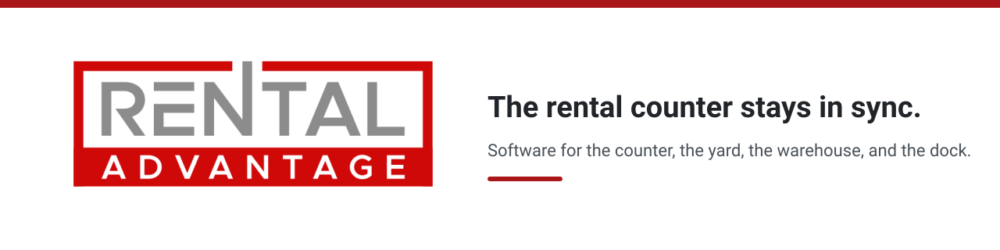

<picture>
  <source media="(prefers-color-scheme: dark)" srcset="banner-dark.svg">
  
</picture>

You'll see the contract, the unit, and the return without chasing paper or calling the yard.

Rental Advantage is first. Warehouse, Yard, Chat, and Loadout Advantage follow.

| Product | What changes for you |
|---|---|
| **Rental Advantage** | Counter staff see check-outs, returns, and open contracts in one place. |
| **Warehouse Advantage** | Pickers get the bin, the count, and the next move before they reach the shelf. |
| **Yard Advantage** | Dispatch sees which unit is in the yard, at the gate, or already on the road. |
| **Chat Advantage** | The crew sees the customer thread next to the contract instead of bouncing between inboxes. |
| **Loadout Advantage** | Drivers and dispatchers confirm the next run before the current load clears the dock. |
